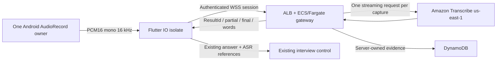

# Amazon Transcribe Streaming: implementation and review gate

Source configuration defaults remain disabled. The user-authorized deployment
and AWS-enabled test APK are recorded in the
[20 October deployment record](aws-transcribe-deployment-2026-10-20.md).
This work does not establish
human transcription accuracy or subsecond conversation latency. The default app
selects `SystemSpeechSttService` when AWS is disabled; no automatic provider fallback occurs
within an answer. Android API 24+ is supported by the dedicated PCM path without
relying on Android 13 recognizer audio injection.

## Current and new paths

The existing provider owns the microphone through Android recognition. Speech
segments accumulate within a question; TTS finishes before listening begins.
The hands-free pause policy reaches one capture finalizer.
Answers retain their `turnId`, `clientTurnId`, durable receipt, owner, duplicate
guard and retry identity through the existing WebSocket → SQS → Lambda path.
Termination, foreground/background transitions and account changes fence stale
callbacks and stop capture. That control and Polly path remains in place.

The optional path is:

Code is divided into the native `AwsPcmCapture`/`Pcm16Chunker`, typed Flutter
`AwsTranscript`, `AwsTranscribeSttService` and IO transport, the Lambda ticket
route and `sttSession` evidence validator, and the separate `backend/audio-gateway`
package. Its container copies only production source and locked dependencies.
Trial concepts were checked against the supplied local `transcribe-trial`
README, VALIDATION, core and metrics modules. Trial timings are not app results.

## Authentication, coordination and retention

`POST /interview/stt-ticket` uses the existing Firebase authorizer and checks a
fresh, verified, non-revoked Firebase proof again. The requested UID is never
accepted from the body. The current owner, `USER_RESPONDING` state and exact
question `turnId` must match. A transaction fences deletion and concurrent
question changes, checks the shared rollout switch and limits ticket issuance
to 12 per user per minute. Tickets contain 256 random bits, expire in at most
30 seconds, and are stored only by SHA-256 hash. They are sent in the first WSS
frame, never a URL, query parameter, access log or permanent mobile credential.

Redemption atomically consumes the ticket, claims a per-user lease and a global
slot, increments a shared daily admission counter and rechecks question/deletion
authorization. The task role supplies AWS credentials. Shared CONTROL limits,
not per-process counters, govern replica-wide admission. Local process limits
can only reduce capacity. Authorization is rechecked every two seconds, even
during silence. Expiry is bounded by the Firebase token and 180-second capture
limit. A crashed task's lease expires after the bounded stream window; another
task cannot immediately preempt it and create overlapping streams.

Raw PCM is not retained by the production gateway. Final recognized text,
timestamped word evidence and diagnostics expire logically after one hour;
DynamoDB TTL deletion is asynchronous. Accepted answers keep original ASR text
and any explicit correction separately in their owned transcript/receipt.
Confidence applies to the original recognition only. Account deletion removes
owned ticket, stream and rate-limit rows and fences late gateway writes.
Aggregate admission counters contain no candidate identity. Logs contain counts,
durations and status, not audio, tickets, Firebase tokens or recognized words.

## Audio and protocol

Android verifies AudioRecord's actual mono PCM16/16-kHz configuration. Unsupported
format initialization fails; samples are never relabelled as a different rate.
The bridge assembles 2,560-byte / 80-ms chunks and preserves sample counts,
silence duration and a short final tail. Recording/recognition ownership is handed off only after the
old recognizer and optional recording release. Native audio reading and socket
framing/networking run off the rendering thread. Normal stop keeps the final
read, flushes its tail and waits for bounded final result drainage.

Each binary frame has a 12-byte little-endian prefix: uint32 sequence and uint64
absolute sample offset, followed by PCM. WAV headers are not sent. Sequence or
offset gaps, odd-sized samples, incorrect rate, a chunk following a short tail,
overrun, muted capture, capture starvation and bounded-queue overflow fail
visibly. Android requests VOICE_COMMUNICATION, with VOICE_RECOGNITION as an
initialization fallback, and enables available platform echo cancellation and
noise suppression. A pinned, offline WebRTC VAD (android-vad 2.0.10, aggressive
mode, 20-ms/16-kHz frames) classifies activity. Its gate retains 160 ms of pre-roll
and 240 ms of trailing audio; non-speech is zero-filled, never removed or
renumbered. A transport gap still fails visibly rather than being filled.
When VAD cannot initialize, capture retains its PCM and the amplitude endpoint
fallback; diagnostics identify the active capabilities. Hardware effectiveness
and soft speech need device acceptance. Clipping and observed timing
are exposed as recording diagnostics. They do not grade the candidate.

Native and network acknowledgement windows bound outstanding audio to roughly
1.6 seconds; the SDK audio queue is limited to 64,000 bytes. Incoming and outgoing
messages and recognized text have independent bounds. The gateway accepts only
near-real-time PCM, stops on disconnect/cancel/expiry/termination, sends pings,
and drains final results for at most eight seconds. Persisting evidence must
succeed before `complete` is sent. ALB idle timeout is 240 seconds; ECS graceful
stop is 20 seconds, with a ten-second application drain.

Control frames are `start` (protocol 1 + ticket), `end` (frame count + next sample
offset), and `cancel`. Responses are `ready`, `ack`, `transcript`, `complete`,
`interrupted`, or `error`. Transcripts include provider, language, stream ID,
capture ID/epoch, session/question IDs, ResultId, partial status, segment start/end
and pronunciation items with timestamps, nullable raw confidence and nullable
Stable. Partials replace only the same ResultId in the same stream/epoch; a late
partial cannot overwrite a final. Legitimate repeated words remain intact.

Reconnects use a new ticket and stream. The new origin is derived from the prior
server-received sample boundary and explicitly linked by `previousStreamId`.
There is no automatic audio replay or claim that separate stream timestamps
have the same origin. Transport gaps are interruptions, not synthesized silence.
Unfinished text remains diagnostic, never finalized answer text. Earlier final
segments remain available; the user is prompted to repeat the interrupted portion.
Automatic endpoint submission stays blocked until new speech in the resumed
stream is finalized. Reconnection, noise and silence alone do not confirm recovery.
If the completion response alone was lost, the server's already completed
evidence is recovered and submitted without another microphone or paid stream.

## Answer boundaries and confidence

A final AWS segment never submits an interview answer. Following the user's
request to retain the stable hands-free interface, the experimental AWS path
automatically finishes after at least four seconds of silence and initially waits
up to 15 seconds for speech. There is no Done button in the interview screen.
The local speech detector, rather than loudness alone, resets this pause timer.
ASR hypotheses do not reset it. This is not linguistic turn completion and requires thinking-pause/noise
device evaluation. Default Android behavior is unchanged. TTS playback/listening
boundaries and receipt-based exactly-once submission are retained.

Recorder/effect allocation starts after permission is granted. Each question
prefetches its short-lived access ticket during TTS playback, without opening a
paid recognition stream or recording the question. Only the matching question
can consume that ticket; expired/failed preparations fall back to normal ticket
issuance. The native idle allocation expires after 30 seconds and is released
on background/close. Microphone recording still waits for TTS shutdown. Readiness
time and echo/noise/VAD availability are exposed in speech diagnostics.

The interview screen uses the exact stable v1.0.9 UI again, at the user's
request. Its particle sphere, transcript viewport and recovery controls match
the same tag. The experimental question/control/status slot layout was removed;
microphone preparation and noise filtering remain independent of the UI.
No Done button or paid enhancement service is added. Bundled VAD notices are in
`frontend/assets/licenses/webrtc-vad.txt`.

Only finalized pronunciation items enter confidence summaries. Missing confidence
is null; true zero is retained; punctuation is excluded. Stable is independent
of confidence and finality. Mean confidence is labelled recognition confidence,
not measured accuracy or interview ability. The 0.80 low-score threshold is
uncalibrated. Summaries include missing counts and up to 100 low-confidence spans
with an explicit truncation flag; complete final word evidence is retained in the
bounded ASR record. Client-provided confidence is discarded. Edited words never
inherit confidence from the original recognition.

## Vocabulary

`vocabulary/technical-en-IN-v1.tsv` contains public Flutter, AWS, DynamoDB,
PostgreSQL and Kubernetes terms. It has the required Phrase/SoundsLike/IPA/DisplayAs
headers; SoundsLike and IPA values are empty because AWS currently ignores them.
Use the separate provisioning utility with an explicitly scoped S3/data access
role, wait for READY, then configure `technical:en-IN` in VOCABULARY_MANIFEST.
Creation is never synchronous during an answer. The gateway validates READY,
language and us-east-1 before applying a configured vocabulary. Missing manifest
entries are an explicit no-vocabulary baseline; configured unavailable entries
fail rather than silently changing recognition. No candidate/resume PII belongs
in these shared vocabularies. No custom language model is proposed for en-IN.

## Infrastructure and gates

The canonical SAM template adds a conditional STT table and an authenticated
ticket function. The table is not created by default; the route fails closed
when disabled. The optional gateway template requires reviewed VPC/subnets,
immutable private ECR image digest, table ARNs and an ACM certificate matching a
staging hostname in us-east-1. Tasks use private subnets and existing NAT/endpoints;
their ingress allows only the ALB. HTTPS/WSS terminates at the ALB; task egress is
TLS. Least-privilege roles separate ticket issuance, stream admission/evidence,
transcript validation, deletion and image/log delivery.

All of these must be reviewed and deliberately configured before rollout:

1. SAM `CreateAwsSttResources=true`, with `AwsSttRolloutEnabled=false` initially.
2. Gateway `ProvisionGateway=true`, `DesiredCount=0`, `RuntimeEnabled=false`.
3. A CONTROL row in the STT table with `rolloutEnabled=false`,
   `globalStreamSlots=4`, `dailyStreamLimit=20` (or approved lower limits).
4. A validated WSS hostname/certificate and image digest; then staging tasks.
5. Approved staging switches and an explicitly opted-in app build.

Ordinary app flags are `AWS_STT_ENABLED=false`, `AWS_STT_LANGUAGE=en-IN`,
`AWS_STT_STABILITY=off`, and `AWS_STT_PAUSE_MS=4000`.
LOW/MEDIUM/HIGH stabilization are controlled comparisons,
not default accuracy claims. There is no automatic deployment workflow for this
service. Main pushes run checks; they do not deploy or activate it.

Rollback first sets shared CONTROL `rolloutEnabled=false`; streams close on the
next bounded authorization check. Disable ticket/runtime flags and return the
next app/session build to the default Android provider. Do not silently switch
recognizers within an active answer. Keep incomplete drafts visible and prompt
recovery/confirmation. Do not remove tables/evidence while accepted answers are
still awaiting receipts or cleanup.

## Evaluation and clocks

The replay harness sends identical PCM in real time, stripped from validated WAV,
and can compare saved Android hypotheses against AWS results using the same
human-verified reference. Android fixture injection is used only on API33+ review
builds; unsupported devices must be reported, not assumed equivalent.

The manifest requires consent, speaker IDs and calibration/evaluation splits.
The same speaker cannot be in both. Include device, accent, headset and noise
conditions. WER counts substitutions/deletions/insertions using NFKC lowercase
tokens, ignoring punctuation/apostrophes without expanding numbers or acronyms.
Unicode combining marks remain part of words, including Hindi vowel marks.
Technical-term aliases are explicit and reported separately. Confidence evaluation
reports coverage, low-score error precision/recall and deletions with no score.
No raw confidence threshold becomes calibrated without held-out evidence.

Gateway first-partial delay uses one server monotonic clock from first PCM
receipt to partial receipt. Estimated final-segment lag subtracts AWS segment
EndTime from that same clock's elapsed audio-receipt interval; it includes
transport/buffering and may be negative. Client IO timing uses its own monotonic
clock from first socket audio submission. Native sample offsets and timestamps
are not subtracted from unrelated wall clocks. Reconnect offsets and interruption
reasons remain separate. Replay timing starts at first PCM yielded to the SDK.
Client `interruptionToResumedAudioMs` uses one monotonic clock from detection of
an interruption to the first resumed PCM event. It includes retry/user waiting
and microphone startup; it is not a pure network-reconnection measurement.
Probe Start-to-first-text includes permission/ticket/connect startup and must
not be renamed pure ASR latency. p50/p95 are withheld below 30 observations.

No STT timing proves the wider below-one-second target. Four-second automatic
silence waiting alone exceeds it. Existing SQS queueing, Lambda startup/leases,
full Bedrock generation, Polly synthesis, audio fetch and playback buffering
are additional follow-up bottlenecks. This change does not shorten that pause,
replace the question-generation pipeline or claim the full target is met.

## Reproducible checks

From the repository root, install gateway dependencies with
`npm ci --prefix backend/audio-gateway --ignore-scripts`; run its tests with
`npm test --prefix backend/audio-gateway`. Run backend Jest, Flutter analysis/
tests, native `:app:testDebugUnitTest`, canonical SAM lint and gateway template
lint. CI runs the isolated gateway tests/audit but never real paid AWS tests.

`scripts/aws-staging-check.mjs --apply --output <ignored-report>` creates only
uniquely named synthetic tables, exercises real admission/fences, makes one
billable silence request, and deletes those tables. It does not deploy Fargate
or prove TLS/device/human accuracy.

The debug-only `stt_probe_main.dart` builds as the separate `.sttprobe` package,
never as a release. With explicit `AWS_STT_LOOPBACK_PROBE=true`, it can reach a
USB-forwarded loopback test gateway; release builds cannot use cleartext or this
entry point. The helper is not copied into the production container. It reuses
the ticket/admission/stream code with an isolated synthetic identity. It does
not validate the production Firebase/ALB/Fargate deployment. Test recordings and
reports go only to ignored `tmp/aws-stt-phone/`; do not commit them.

Actual results, remaining acceptance items and costs are recorded separately in
`aws-transcribe-validation.md`. Broad rollout remains blocked until representative
human recordings show a worthwhile accuracy improvement. A negative result must
leave the feature disabled.
